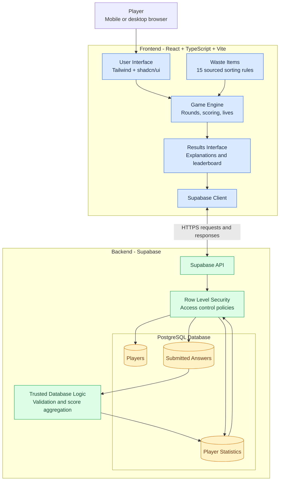

# Which Bin? · Application architecture

<!--
  What this diagram must show (learning goal, Create): the application.

  Questions to answer before you draw:
  - What runs on the phone, and what runs on a server?
  - What crosses the internet?
  - Where do the items and their Omrin rules come from?

  Where the parts are in the code:
  - Screens: app/src/features/
  - Game rules: app/src/domain/game.ts
  - The 15 items: app/src/data/items.json
  - Everything the game saves or reads about players goes through ScoreStore
    (app/src/services/scoreStore.ts, 5 methods). Today it saves on the phone only;
    planned: Supabase, with the same 5 methods.
  - Hosting: Cloudflare Pages (planned, SCRUM-27)

  Draw planned parts with dashed arrows (-.->). Syntax: README.md in this folder.
-->

