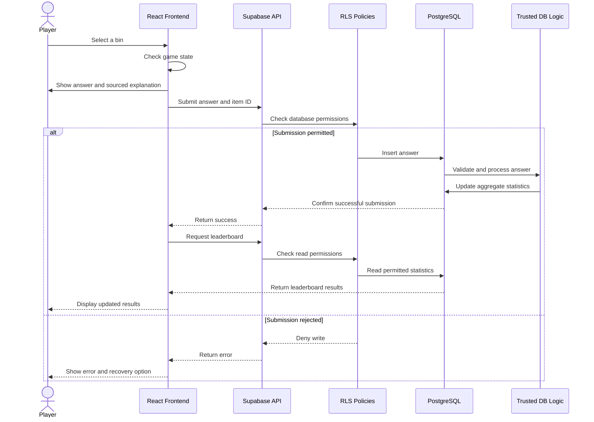

# Which Bin? · Answer submission → storage → database

<!--
  What this diagram must show (learning goal, Create): answer submission → storage → database behaviour.

  Questions to answer before you draw:
  - What happens, in order, from the player's tap or drop on a bin to the answer stored in the database?
  - What may the browser do in the database, and what is refused?
    (Goal: inserting answers is allowed; changing or deleting them is not. Row level security.)
  - What does the player see when saving fails?

  Where it is in the code:
  - Start: handleSelect in app/src/features/round/RoundScreen.tsx. A tap and a drop both end up there.
  - It calls store.submitAnswer(...) with an AnswerRecord (app/src/services/scoreStore.ts).
  - After a wrong answer on the shared store, it calls store.itemStat(itemId) for the number
    the "Not quite" sheet shows.
  - If saving fails: hasSaveError, and the player sees
    "Your answers couldn't be saved. You can keep playing."
  - Planned (Supabase, SCRUM-51 to SCRUM-54): the table the answer goes into, aggregate scores,
    row level security.

  Use alt / else / end for "allowed" and "refused". Syntax: README.md in this folder.
-->

